# Bot pomocniczy do Heroes III (HotA): informacje o turniejach i trade na Discordzie

Bot na Discordzie dla społeczności Heroes of Might and Magic III (Horn of the Abyss). Robi dwie rzeczy:

1. **Informacje o turniejach.** `/info` podaje w jednym miejscu to, co zwykle trzeba szukać w regulaminie: fazy i formaty (BO), kolejność banów i picków, pulę szablonów, a dla każdego szablonu trudność, koszt rolla, timer, mapę, drogi, tury symultaniczne, dodatkowe zasady i **link do pobrania**. Turniej może też podawać link do pełnego regulaminu.
2. **Trade z poziomu Discorda.** Cała faza przed grą odbywa się w wątku Discorda, a nie w lobby: rzut monetą, bany i picki szablonów, losowanie miast i paczek AI, roll z banowaniem miast, losowanie bohaterów (ruletka), licytacje o miasto, paczkę, kolor lub pierwszy wybór, przeliczanie złota i na końcu gotowe ustawienia do wpisania w lobby. Dzięki temu w lobby tylko wpisujecie ustawienia i zaczynacie grę.

Bot obsługuje turnieje organizowane przez h3.gg oraz tryb Ranked do luźnych gier z losowaniem. Formaty turniejów to pliki JSON w repozytorium, więc każdy może dodać nowy przez pull request (zob. [Dla organizatorów](#dla-organizatorów-i-kontrybutorów)). Wszystkie przykłady poniżej są prawdziwymi wiadomościami bota.

## Cztery przykłady użycia

Cztery typowe scenariusze, krok po kroku. Przy każdym kroku opisuję, co robi bot. Reguły gry i turniejów zakładam znane.

### 1. Informacje o szablonie turnieju i link do pobrania

Przykład: One Minute Madness 3.0 w Exotic Tournament III.

**Krok 1. `/info mode:exotic-tournament-3 template:One Minute Madness 3.0`**
Komenda działa w każdym kanale. Tryb i szablon podpowiadają się podczas pisania, szablon spośród tych, które ma dany turniej.

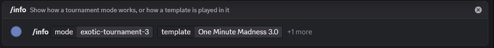

**Krok 2. Odpowiedź bota**
Odpowiedź widzisz tylko Ty. Bot składa ją z danych turnieju i szablonu: trudność, koszt rolla (500 złota, 1 na gracza, do 2 zbanowanych miast), **link do pobrania** (szablon nie jest wbudowany w HotA), timer turnieju, rozmiar mapy, drogi, liczba graczy AI oraz dodatkowe zasady z regulaminu (tu: wersja szablonu i zasada wczesnego spotkania). Brak linii oznacza, że turniej nie określa tego ustawienia. Bot niczego nie dopowiada.

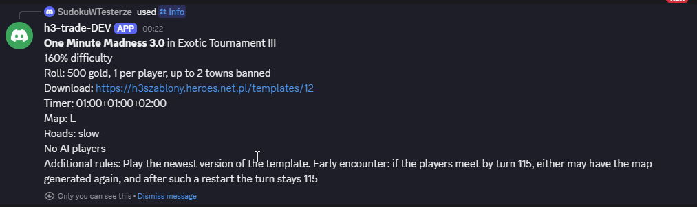

---

### 2. Ruletka bohaterów w King of h3dm2

Przykład: faza „From 1/8 finals" (BO3, szablon lustrzany `h3dm_nc`, ruletka z jednym banem bohatera na gracza).

**Krok 1. `/match start opponent mode:King of h3dm2 phase:From 1/8 finals`**
Wybierasz przeciwnika, tryb i fazę. W fazie „fixed" (jeden szablon na cały mecz) nie podajesz szablonu.

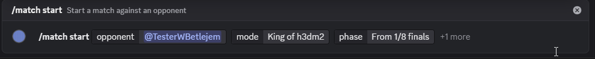

**Krok 2. Bot tworzy wątek**
Wątek ma nazwę z obu graczy. Od tej chwili wszystko dzieje się w nim, a komendy meczu działają tylko dla tych dwóch graczy.

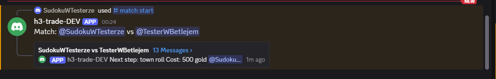

**Krok 3. Zasady, rzut monetą i pierwsze losowanie**
Bot zapisuje start meczu (`[#1 ms]`), podaje format (BO3), link do pełnego regulaminu, szablon z linkiem do pobrania, timer, tury symultaniczne, opis handlu (ruletka: roll, 1 ban bohatera na gracza, bot losuje dwóch bohaterów, jedna licytacja o pierwszy wybór), wersję zastępczą za zgodą graczy (`h3dm1`) i podpowiedź do `/info`. Potem rzut monetą (zwycięzca to A) i handel gry 1: wylosowane miasto, 10 000 złota na start, koszt rolla i liczba rolli każdego z graczy.

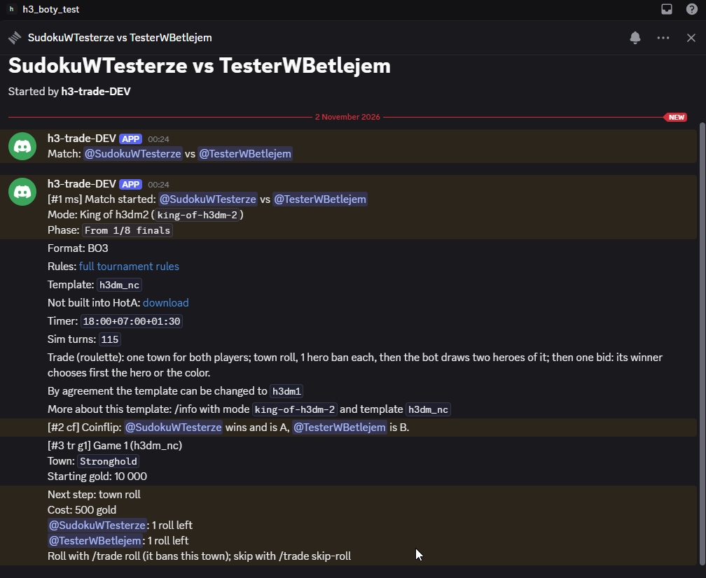

**Krok 4. Roll (opcjonalnie)**
`/trade roll` kosztuje 500 złota płatne przeciwnikowi i banuje wylosowane miasto, po czym bot losuje nowe. `/trade skip-roll` zostawia miasto. Po wykorzystaniu lub pominięciu przez obu graczy etap losowania się kończy, a bot przechodzi do banów bohaterów. Tu obaj gracze zostają przy mieście.

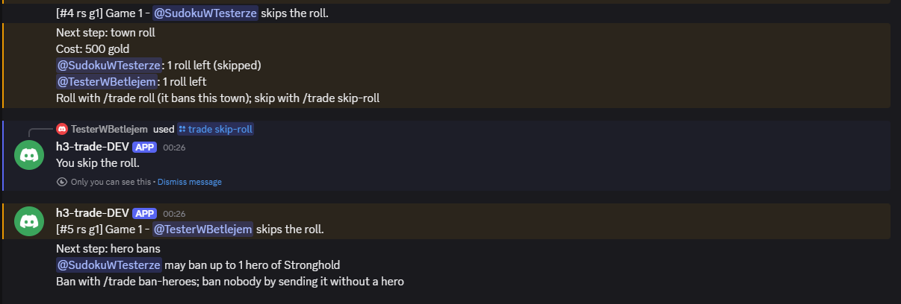

**Krok 5. Bany bohaterów: `/trade ban-heroes hero_1`**
Najpierw A, potem B, każdy do 1 bohatera wylosowanego miasta. Pole `hero_1` podpowiada bohaterów tego miasta, po odjęciu tych niedostępnych na szablonie (zbanowanych przez szablon). Wywołanie bez bohatera oznacza brak bana.

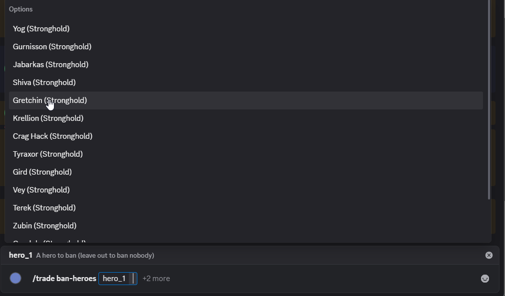

Podpowiedzi zawężają się podczas pisania:

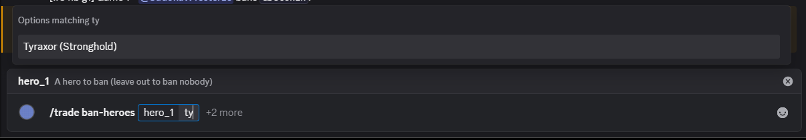

**Krok 6. Losowanie bohaterów**
Po banie drugiego gracza bot **sam losuje dwóch bohaterów** z puli miasta (bez zbanowanych i niedostępnych) i podaje ich z linkami do wiki. Od razu zaczyna się jedyna licytacja lustrzanej ruletki: zwycięzca wybiera, czy pierwszy wybiera bohatera, czy kolor, a drugi gracz dostaje resztę. Licytacja idzie poza botem, wynik zgłasza się przez `/trade report` z `choice:hero` lub `choice:color`.

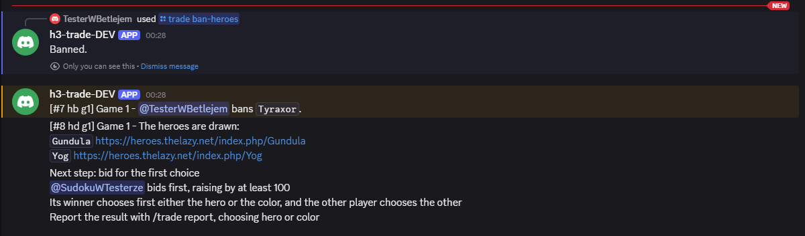

**Krok 7. Licytacja, zgłoszenie wyniku i ustawienia lobby**
Gracze licytują się poza botem (na czacie), a jeden z nich zgłasza wynik: `/trade report` z wygranym, kwotą i `choice:hero` albo `choice:color`. Bot zapisuje wynik (`[#9 fb g1]`) i przelicza złoto. Potem podaje ustawienia lobby: timer, mapę, drogi, miasto, obu bohaterów oraz dla każdego gracza, kto wybiera pierwszy bohatera lub kolor, i różnicę złota. Na końcu mówi, że następna jest gra 2 i jak otworzyć jej handel.

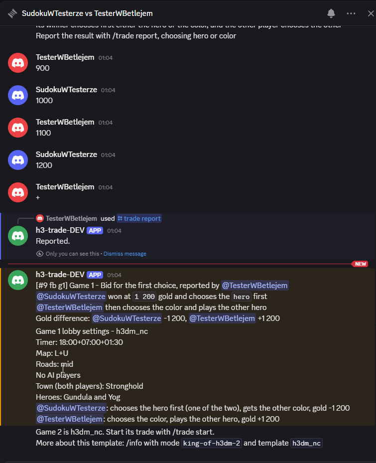

---

### 3. Luźna gra rankingowa z ruletką (tryb Ranked)

Przykład: faza „Non-mirror 160%", szablon „Roulette with AI packs 160%" (para miast, dwie paczki AI, bohaterowie dla miast).

**Krok 1. `/match start mode:Ranked phase:Non-mirror 160% template:...`**
W Ranked faza ustala trudność (tu 160%, czyli 10 000 złota) i to, czy gra jest lustrzana, a szablon to **rodzaj losowania**. Cztery nielustrzane: Standard, Standard with AI packs, Roulette, Roulette with AI packs.

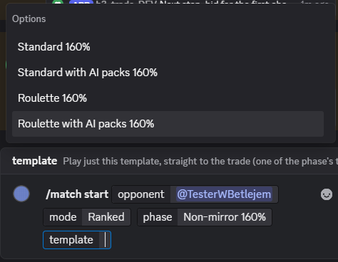

**Krok 2. Wątek**
Szablon jest podany, więc nie ma banów ani picków: bot tworzy wątek i od razu otwiera handel jedynej gry.

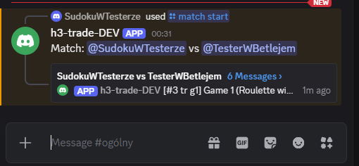

**Krok 3. Zasady i losowanie**
Bot zapisuje start, podaje format (BO1) i opis handlu, losuje A i **losuje parę miast oraz dwie paczki po trzy miasta AI** (osiem różnych miast). Podaje 10 000 złota na start i stan rolli (koszt 500, po jednym na gracza, do 2 zbanowanych miast pary).

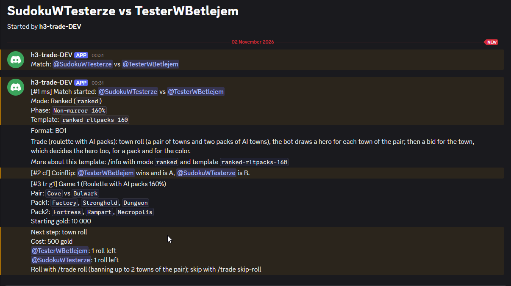

**Krok 4. Roll**
`/trade roll ban_1 ban_2` lub `/trade skip-roll`. Roll banuje miasta tylko z pary (zbanowane miasto może wypaść w paczce AI) i losuje na nowo parę oraz obie paczki. Tu obaj gracze rezygnują.

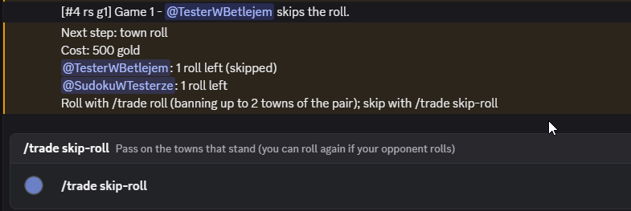

**Krok 5. Losowanie bohaterów**
Bez banów (w tym szablonie `hero_bans` to 0) bot od razu losuje po jednym bohaterze dla każdego miasta pary. Bohater jest przypisany do miasta: kto wygra licytację o miasto, dostaje też jego bohatera. Zaczyna licytację A.

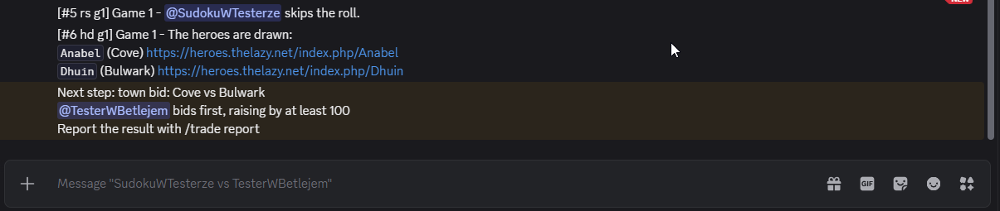

**Krok 6. Trzy licytacje i `/trade report`**
Licytacje idą poza botem, a wynik zgłasza jeden z graczy: najpierw miasto (z bohaterem), potem paczka AI, na końcu kolor. Po każdym zgłoszeniu bot przelicza różnicę złota.

**Krok 7. Ustawienia lobby**
Podsumowanie: dla każdego gracza miasto z bohaterem, paczka AI (z miastami), kolor i różnica złota względem startu. Gracz czerwony jest pierwszy.

**Krok 8. `/match status`**
Pokazuje fazę, A i B, stan gry (czy handel trwa, co dalej, różnica złota, paczki AI) oraz numerowaną listę zapisanych kroków, tak jak bot odczytał je z wątku.

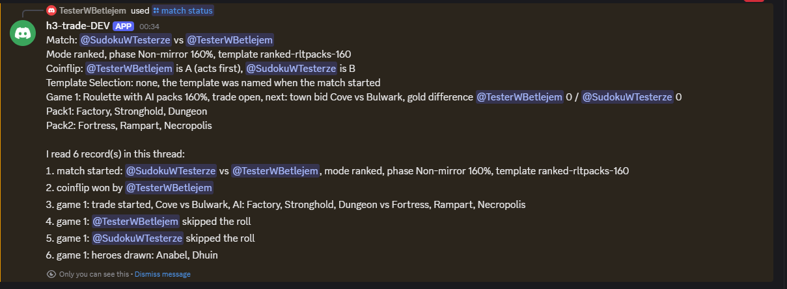

Pozostałe fazy Ranked: **Non-mirror 130%** (15 000 złota) oraz **Mirror 130%** i **Mirror 160%** (jedno miasto dla obu graczy, ruletka bez banów albo z 1, 2 lub 3 banami bohaterów na gracza). Zob. [Tryb Ranked](#tryb-ranked-losowanie-dla-siebie).

---

### 4. Bany i picki w finale Mistrzostw Polski

Przykład: faza „Final" (BO3, dziewięć szablonów, kolejność `ABABABBA` plus decider).

**Krok 1. `/match start mode:Mistrzostwa Polski 2026 phase:Final`**
Bot zapisuje start, podaje format, link do regulaminu, **kolejność wyboru** (`ABABABBA: A bans, B bans, A picks, B picks, A bans, B bans, B bans, A bans, then decider`) i pulę dziewięciu szablonów, losuje A i wskazuje pierwszy krok.

**Krok 2. `/ban template:...` i `/pick template:...` na zmianę**
Bot przyjmuje tylko komendę gracza, który ma teraz krok, i tylko szablon, który został. Każdy krok zapisuje (`[#3 bn]`, `[#5 pk]`), pokazuje pozostałe szablony, listę zbanowanych i wybranych oraz kolejny krok.

**Krok 3. Pick ustala grę**
Pierwszy pick to gra 1, drugi to gra 2, a ostatni nieużyty szablon (decider) to gra 3. Handel gry można zacząć, gdy jej szablon jest znany, nawet zanim skończą się bany, i bot to zaznacza.

**Krok 4. Ostatni ban i decider**
Po ostatnim banie (krok 8, A) zostaje jeden szablon, który bot zapisuje jako grę 3. Bot podaje listę gier w kolejności rozgrywania.

Pomyłkę w kroku cofa `/match undo` (druga strona musi się zgodzić). Handel każdej gry zaczyna się osobnym `/trade start`.

Jak wygląda cały mecz, krok po kroku na zrzutach ekranu (start, bany, handel, ustawienia lobby): zob. [Przebieg meczu krok po kroku](#przebieg-meczu-krok-po-kroku).

---

## Spis treści

0. [Cztery przykłady użycia](#cztery-przykłady-użycia)
1. [Najważniejsze zasady](#najważniejsze-zasady)
2. [Komendy](#komendy)
3. [Przebieg meczu krok po kroku](#przebieg-meczu-krok-po-kroku)
4. [Wybór szablonów: bany i picki](#wybór-szablonów-bany-i-picki)
5. [Handel (trade)](#handel-trade)
6. [Rodzaje handlu](#rodzaje-handlu)
7. [Ustawienia lobby](#ustawienia-lobby)
8. [Cofanie, status i wznawianie](#cofanie-status-i-wznawianie)
9. [Komenda /info](#komenda-info)
10. [Turnieje dostępne w bocie](#turnieje-dostępne-w-bocie)
11. [Pytania i problemy](#pytania-i-problemy)
12. [Dla organizatorów i kontrybutorów](#dla-organizatorów-i-kontrybutorów)

---

## Najważniejsze zasady

- **Jeden mecz = jeden wątek.** `/match start` tworzy wątek. Wszystko, co dotyczy meczu, dzieje się w tym wątku.
- **Tylko dwóch graczy.** Komendy meczu działają tylko dla dwóch graczy z wątku. Nikt inny ich nie użyje.
- **Bot nie ma bazy danych.** Stan meczu to wiadomości samego bota w wątku, zaczynające się znacznikiem w rodzaju `[#7 tb g1]` (numer, rodzaj kroku, numer gry). **Nie usuwaj i nie edytuj wiadomości bota.** Jeśli czegoś brakuje, bot nie zgaduje, tylko mówi, że nie może odczytać meczu.
- **Gracz A to zwycięzca rzutu monetą**, B to drugi gracz. A zaczyna bany i licytacje.
- **Co widzisz tylko Ty.** Potwierdzenia komend (np. „You banned 6lm10a.") i błędy widzi tylko osoba, która wpisała komendę. Reszta (zapis kroku, co dalej) trafia do wątku.
- **Kwoty złota** są zawsze w pełnych setkach i zapisywane ze spacją (`10 000`).
- **Bot niczego nie wymyśla.** Jeśli reguły turnieju czegoś nie określają, jest to zapisane jako otwarte pytanie, a nie zgadnięte.

## Komendy

| Komenda | Do czego | Kto |
|---|---|---|
| `/match start` | Rozpoczyna mecz: tworzy wątek, rzuca monetą i prowadzi do pierwszego kroku. Opcje: `opponent`, `mode`, `phase` (tylko gdy tryb ma kilka faz), `template` (gra od razu na jednym szablonie, jedna gra). | każdy, w zwykłym kanale tekstowym |
| `/ban` | Banuje szablon, gdy jest Twoja kolej. | gracz w wątku |
| `/pick` | Wybiera szablon, gdy jest Twoja kolej. | gracz w wątku |
| `/trade start` | Otwiera handel gry (numer, szablon albo bez parametru: pierwsza gra, która nie jest skończona). | gracz w wątku |
| `/trade roll` | Płaci za nowe losowanie miast i banuje miasta z obecnej pary (do limitu). | gracz w wątku |
| `/trade skip-roll` | Rezygnuje z losowania na obecnych miastach. | gracz w wątku |
| `/trade report` | Zgłasza wynik licytacji: `winner`, `amount`, `choice`. | gracz w wątku |
| `/trade ban-heroes` | Banuje bohaterów przed losowaniem (tylko ruletka). | gracz w wątku |
| `/match status` | Pokazuje stan meczu i zapisane kroki. | gracz w wątku |
| `/match undo` | Prosi o cofnięcie od wskazanego zapisu, albo się na nie zgadza. | gracz w wątku |
| `/info` | Opisuje tryb turnieju albo szablon w nim. Odpowiedź tylko dla Ciebie, można użyć wszędzie. | każdy |

Komendy podpowiadają wartości (szablony, miasta, kolory, bohaterów), więc zwykle wystarczy wybrać z listy.

---

## Przebieg meczu krok po kroku

Przykład: faza grupowa Mistrzostw Polski, jedna gra. Szablon wybierają dwa bany, a ostatni szablon zostaje grą („decider"). Poniżej jest cały mecz od komendy startowej do ustawień lobby, na prawdziwych zrzutach z Discorda.

### 1. Start

Gracz wpisuje `/match start`, wybiera przeciwnika i tryb. Tryb z kilkoma fazami pyta jeszcze o fazę, a bot podpowiada ich nazwy:

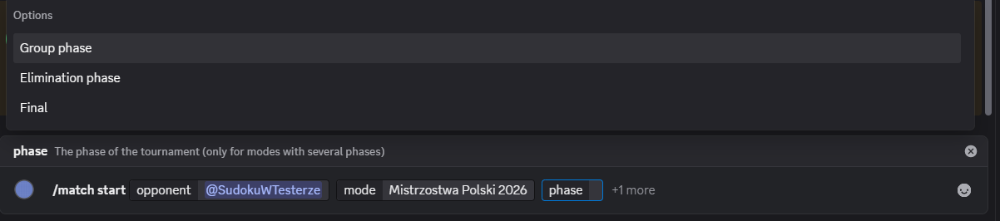

Bot tworzy wątek, pisze zasady fazy (razem z **linkiem do pełnego regulaminu turnieju**), losuje, kto jest A, i mówi, kto zaczyna:

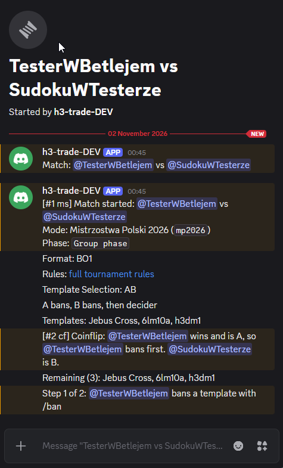

W tekście to wygląda tak:

### 2. Bany szablonów

A (zwycięzca rzutu monetą) wpisuje `/ban`. Lista podpowiada szablony, które jeszcze zostały:

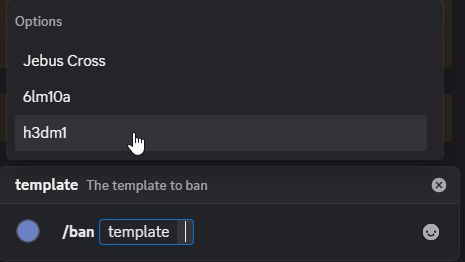

Bot zapisuje ban i pokazuje, co zostało i czyja kolej:

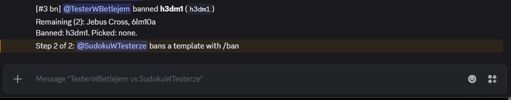

Teraz B. Zbanowany szablon znika z listy:

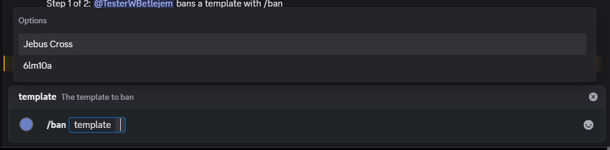

Ostatni szablon zostaje grą, a bot od razu mówi, jak zacząć jej handel i gdzie dowiedzieć się o niej więcej:

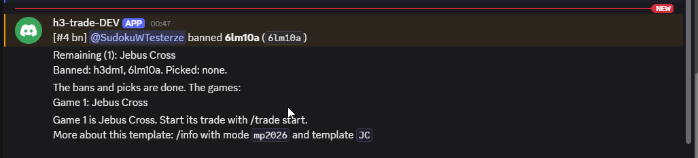

### 3. Handel

`/trade start` otwiera handel gry. Bot podaje, co trzeba wiedzieć o szablonie (timer, tury symultaniczne, jak wygląda handel), losuje **parę miast** i podaje, ile złota macie na starcie, jakie dodatkowe zasady ma szablon i co robić dalej:

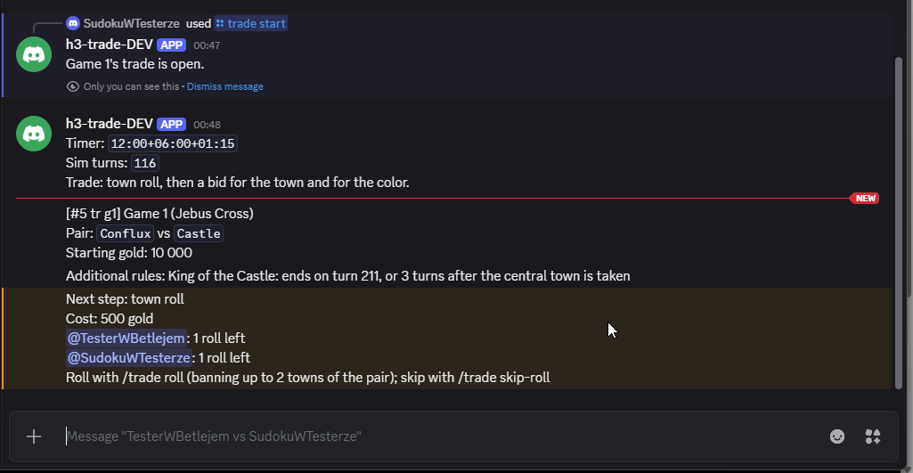

**Losowanie miast (roll).** Każdy może raz zapłacić 500 złota za nowe losowanie i zbanować do dwóch miast z pary (`ban_1`, `ban_2`). Lista podpowiada miasta z obecnej pary:

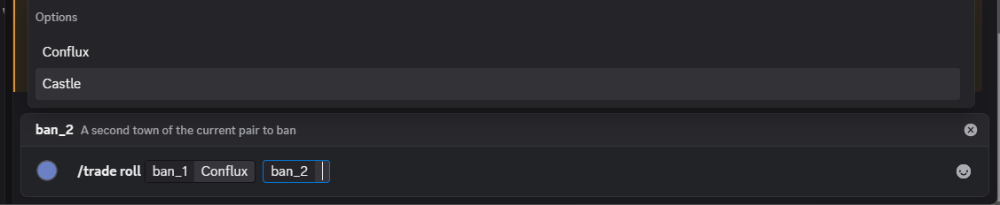

Bot losuje nową parę bez zbanowanych miast i liczy złoto: kto zapłacił, ma minus, przeciwnik plus. Zostaje już tylko jedna możliwość losowania, dla drugiego gracza:

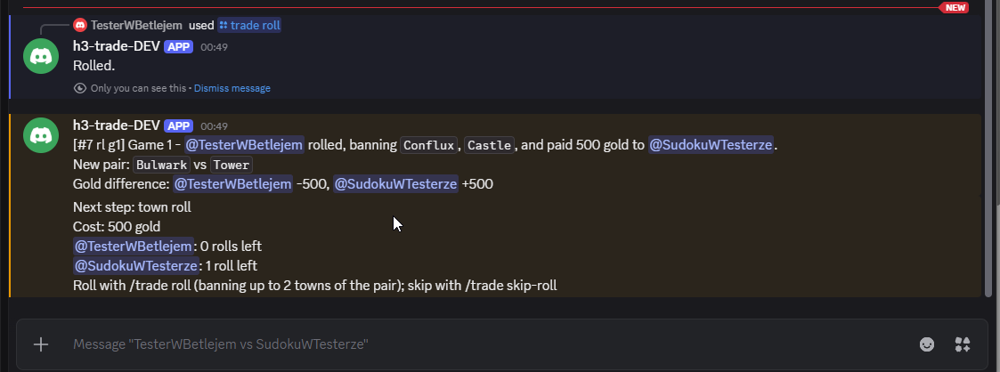

**Licytacja o miasto.** Gdy losowanie jest zamknięte (obaj zrezygnowali albo wykorzystali swoje), zaczyna się licytacja. **Licytacja odbywa się poza botem**: na czacie albo głosowo, jak zawsze. Zaczyna A, kolejne oferty rosną co najmniej o 100. Kiedy wynik jest ustalony, jeden z graczy zgłasza go komendą `/trade report` (zwycięzca, kwota, wybrane miasto):

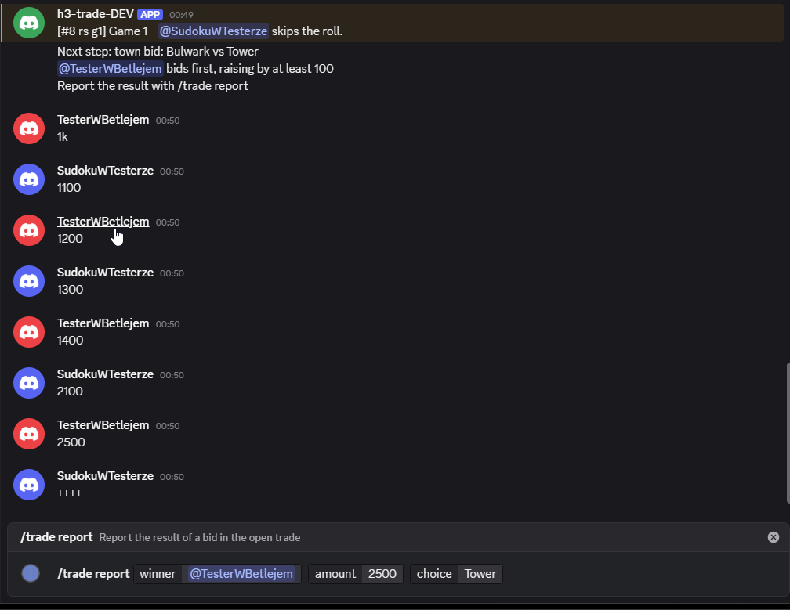

Bot zapisuje wynik, przelicza złoto i przechodzi do następnej licytacji, o kolor. Tak samo zgłaszacie kolor (`red` albo `blue`):

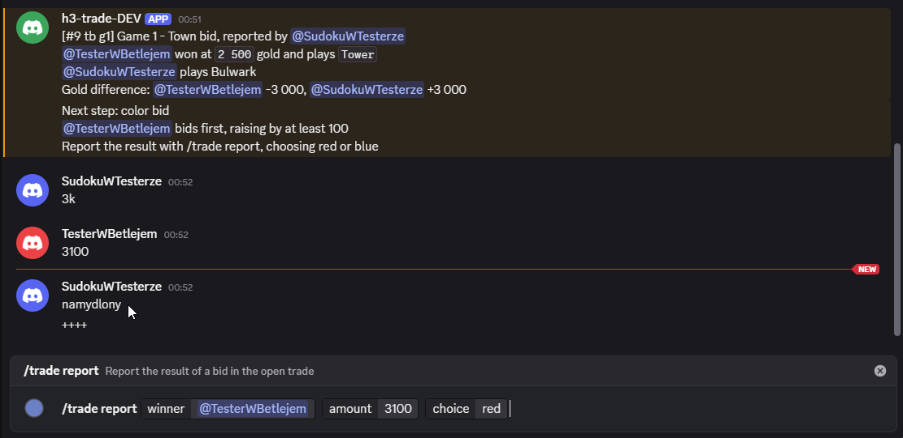

### 4. Ustawienia lobby

Po ostatniej licytacji bot podaje podsumowanie, które wpisujecie w lobby HotA: ustawienia szablonu oraz, dla każdego gracza, miasto, kolor i różnicę złota. **Gracz czerwony jest zawsze pierwszy.** Na końcu bot mówi, co dalej (tutaj: że to była jedyna gra meczu):

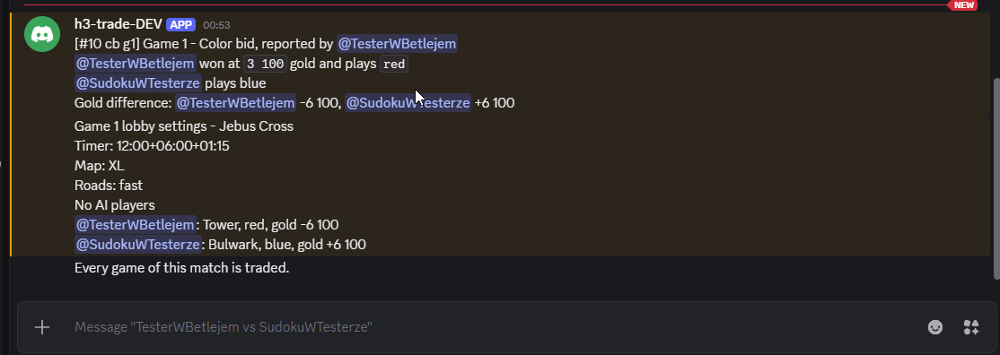

Dalej: wchodzicie do lobby HotA i wpisujecie to, co podał bot. **Wynik meczu zgłaszacie tak, jak ustala regulamin turnieju (np. na h3.gg)**. Bot nie śledzi wyników gier.

W każdej chwili `/match status` pokazuje, na jakim jesteście kroku i co bot zapisał, z numerowaną listą zapisów:

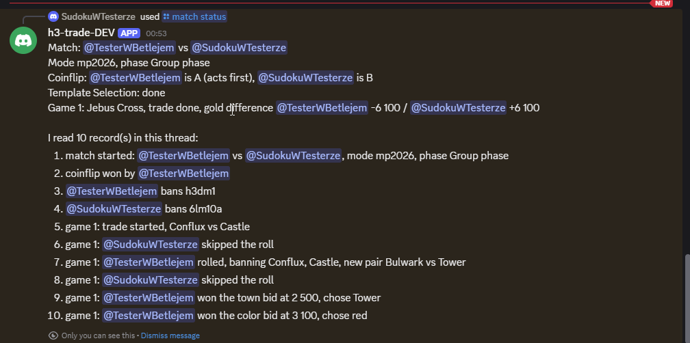

---

## Wybór szablonów: bany i picki

Sposób wyboru jest zapisany w formacie fazy i jest opisany w `/info`. Zapis „ABABABBA" czytamy po kolei: A banuje, B banuje, A wybiera (pick), B wybiera, A banuje, B banuje, B banuje, A banuje, a ostatni szablon trafia do „decidera" (ostatnia gra).

- **Bany i picki.** `/ban` i `/pick` w swojej kolei. Bot po każdym kroku pokazuje, co zostało (`Remaining`), kto co zbanował i czyja kolej.
- **Pick** ustala szablon kolejnej gry w kolejności pików. Decider, jeśli jest, to ostatnia gra. Handel gry można zacząć, gdy jej szablon jest już znany, także zanim skończą się bany.
- **Mecz na jednym szablonie.** Jeśli przy `/match start` podasz `template`, mecz ma jedną grę na tym szablonie, bez banów, i bot od razu otwiera handel. W fazach, w których gracze uzgadniają szablon, podanie go jest obowiązkowe.
- **Faza „fixed" (jeden szablon na cały mecz).** Niektóre turnieje grają wszystkie gry meczu na jednym szablonie (np. Sapphire Battlegrounds 3). Wtedy nie podajesz szablonu, nie ma banów, a bot po kolei zapowiada kolejne gry.
- **Ligi i mecze BO2.** W lidze bany/picki to zwykle ban–ban–pick–pick. Szablony, których nikt nie zbanował ani nie wybrał, po prostu nie są grane.
- **Pomyłka?** Cofnij ją komendą `/match undo` (zob. [Cofanie](#cofanie-status-i-wznawianie)).

---

## Handel (trade)

Handel to wszystko, co dzieje się po wyborze szablonu, a przed wejściem do gry: miasta, kolor i (w ruletce) bohaterowie. Bot losuje i pilnuje złota, a Wy zgłaszacie wyniki licytacji, które ustalacie między sobą (na czacie, w rozmowie głosowej), tak jak zawsze.

### Złoto

Każdy gracz zaczyna z pulą złota zależną od trudności szablonu: **160% = 10 000**, 130% = 15 000, 100% = 20 000. Bot liczy różnicę względem startu (`Gold difference: <@1> +500, <@2> -500`) i pilnuje, żeby nikt nie zapłacił więcej, niż ma. Wszystkie płatności idą do przeciwnika, więc suma jest stała.

Szablony 200% nie mają jeszcze handlu w bocie (rzut o kolor, losowe miasta), więc dla nich bot mówi, że handlu nie ma.

### Losowanie miast (roll)

Bot losuje parę miast (albo jedno miasto na szablonach lustrzanych). Każdy gracz może raz zapłacić za nowe losowanie:

- `/trade roll` – płacisz koszt losowania (domyślnie 500 złota, zależnie od turnieju i szablonu) przeciwnikowi i **banujesz** do dwóch miast z obecnej pary (opcje `ban_1`, `ban_2`). Bot losuje nową parę bez zbanowanych miast.
- `/trade skip-roll` – rezygnujesz z losowania na obecnych miastach. Jeśli przeciwnik zrobi roll i miasta się zmienią, możesz znów wybrać.
- Etap losowania kończy się, gdy nikt już nie może lub nie chce losować.

```
[#6 rl g1] Game 1 - <@2> rolled, banning `Cove`, and paid 500 gold to <@1>.
New town: `Necropolis`
Gold difference: <@1> +500, <@2> -500
Next step: town roll
Cost: 500 gold
<@1>: 1 roll left
<@2>: 0 rolls left
Roll with /trade roll (it bans this town); skip with /trade skip-roll
```

Przy „skip" bot dopisuje przy graczu `(skipped)`. Losowanie możesz zrobić bez banowania, jeśli nie podasz `ban_1`.

### Licytacja i zgłaszanie wyniku

Licytacja odbywa się **poza botem**. Zaczyna A, kolejne oferty rosną co najmniej o 100. Kiedy ustalicie wynik, **jeden z graczy** wpisuje:

```
/trade report winner:@TesterWBetlejem amount:300 choice:red
```

- `winner` – kto wygrał licytację,
- `amount` – ile płaci przeciwnikowi (pełne setki; `0`, jeśli nikt nie licytował),
- `choice` – wybór zwycięzcy: miasto z pary, `pack1`/`pack2` (paczka AI), `red`/`blue` (kolor), `hero`/`color` (ruletka lustrzana). Bot podpowiada właściwe wartości w danym kroku.

```
[#8 cb g1] Game 1 - Color bid, reported by <@2>
<@2> won at `300` gold and plays `red`
<@1> plays blue
Gold difference: <@1> +800, <@2> -800
```

Jeśli kwota jest nieprawidłowa (nie setki, więcej niż ma zwycięzca) albo wybór nie pasuje do kroku, bot odmawia i mówi dlaczego.

---

## Rodzaje handlu

Rodzaj handlu zależy od szablonu i fazy turnieju. Bot mówi o nim w zasadach (`Trade: ...`) i w `/info`.

| Rodzaj | Kroki |
|---|---|
| **Standardowy** | losowanie pary miast → licytacja o miasto → licytacja o kolor |
| **Lustrzany** (szablon lustrzany) | losowanie jednego miasta → licytacja o kolor (bohaterów wybieracie sami, według zasad turnieju, które znajdziesz w `/info`) |
| **Z paczkami AI** (np. Sapphire) | para miast + dwie paczki po trzy miasta AI → licytacja o miasto → o paczkę → o kolor |
| **Ruletka** | losowanie miast → bany bohaterów → bot losuje bohaterów → licytacje |
| **Ruletka z paczkami AI** | jak ruletka, plus paczki AI i licytacja o paczkę |

### Ruletka bohaterów

W ruletce bohaterów losuje bot (zamiast zewnętrznej strony). Bohaterowie pochodzą z wylosowanych miast i z listy dozwolonych na danym szablonie (bot zna listy zbanowanych i odblokowanych bohaterów dla każdego szablonu).

- Po losowaniu miast każdy gracz może zbanować określoną liczbę bohaterów (`/trade ban-heroes`, bez parametrów = nikogo). Najpierw A, potem B.
- Bot losuje bohaterów i podaje ich z linkiem do wiki.
- **Nielustrzany:** licytacja o miasto (zwycięzca dostaje miasto razem z jego bohaterem), potem o kolor.
- **Lustrzany:** jedna licytacja. Zwycięzca wybiera, czy najpierw wybiera bohatera, czy kolor, a drugi gracz dostaje resztę.
- W niektórych turniejach bohaterowie są losowani razem z miastami (wtedy nie ma banów), co opisuje `/info`.

Przykład: ruletka na szablonie lustrzanym (King of h3dm2, od 1/8 finału).

```
[#8 hd g1] Game 1 - The heroes are drawn:
`Spadum` <https://heroes.thelazy.net/index.php/Spadum>
`Akka` <https://heroes.thelazy.net/index.php/Akka>
Next step: bid for the first choice
<@1> bids first, raising by at least 100
Its winner chooses first either the hero or the color, and the other player chooses the other
Report the result with /trade report, choosing hero or color
```


---

## Ustawienia lobby

Gdy ostatnia licytacja jest zgłoszona, bot podaje, co wpisać w lobby. Na górze pojawiają się ustawienia, które w turnieju są określone (timer, rozmiar mapy, drogi, gracze komputerowi), a pod nimi to, co ustaliliście w handlu. **Gracz czerwony jest zawsze pierwszy.**

```
Game 1 lobby settings - h3dm1
Timer: 18:00+07:00+01:30
Map: L+U
Roads: mid
No AI players
Town (both players): Necropolis
<@2>: red, gold -800
<@1>: blue, gold +800
```

Przy szablonie z paczkami AI w linii gracza pojawia się jego paczka (`pack2 (Stronghold, Fortress, Cove)`), a w ruletce bohater przy mieście (`Castle (Orrin)`). Liczba przy graczu to jego różnica w złocie względem startu (po licytacjach i płatnościach za losowanie): o tyle zyskał lub stracił złota.


---

## Cofanie, status i wznawianie

### `/match status`

Pokazuje stan meczu: kto jest A, jak idzie wybór szablonów, każdą grę (szablon, czy handel trwa, co dalej, różnica złota, paczki AI) oraz **numerowaną listę zapisanych kroków**, tak jak bot je odczytał z wątku.

```
Match: <@1> vs <@2>
Mode mp2026, phase Group phase
Coinflip: <@1> is A (acts first), <@2> is B
Template Selection: done
Game 1: h3dm1, trade done, gold difference <@1> +800 / <@2> -800

I read 8 record(s) in this thread:
1. match started: <@1> vs <@2>, mode mp2026, phase Group phase
...
8. game 1: <@2> won the color bid at 300, chose red
```

### `/match undo`

Cofa mecz do stanu **sprzed wskazanego zapisu** (numer jest w `[#7 ...]`). Dotyczy wszystkiego od tego zapisu do końca. Żadna wiadomość nie jest usuwana; bot tylko przestaje je liczyć.

1. Jeden gracz: `/match undo from:7`. Bot zapisuje prośbę.
2. **Drugi gracz** musi się zgodzić: `/match undo` (bez numeru).
3. Bot potwierdza i pokazuje, co dalej.

```
[#9 ur] <@1> asks to undo from record `7` (game 1: <@1> skipped the roll) and the 1 step after it. ...
<@2>, to agree, run /match undo
[#10 ud] <@2> agreed: the match is back to how it was before record `7`.
```

Start meczu i rzut monetą nie mogą być cofnięte. W ruletce nie da się cofnąć samego losowania bohaterów (cofasz ostatni ban, a losowanie powtarza się po nim).

### Wznawianie

`/trade start` na grze, której handel był już rozpoczęty, otwiera go ponownie i pokazuje różnicę złota do tej pory. Jeśli rozpoczniesz handel innej gry, otwarty handel zostaje zamknięty (bot to zaznacza). Można do niego wrócić.

---

## Komenda /info

`/info` pokazuje opis trybu lub szablonu w nim. Odpowiedź widzisz tylko Ty i możesz jej użyć w dowolnym kanale.

- `/info mode:mp2026` – link do regulaminu turnieju, fazy, ich format (BO), sposób wyboru szablonów i dodatkowe zasady.
- `/info mode:mp2026 template:Jebus Cross` – trudność, koszt losowania, timer, mapa, drogi, tury symultaniczne i dodatkowe zasady szablonu. Opcja `phase` zawęża odpowiedź do jednej fazy.

```
**Jebus Cross** in Mistrzostwa Polski 2026
160% difficulty
Roll: 500 gold, 1 per player, up to 2 towns banned
Built into HotA
Timer: 12:00+06:00+01:15
Map: XL
Roads: fast
No AI players
Sim turns until 116
```

### Wersje alternatywne szablonów

Niektóre turnieje pozwalają, za zgodą graczy, zagrać na innej wersji szablonu (np. `h3dm_nc` zamiast `h3dm1`). Bot przy otwarciu handlu pisze wtedy: ``By agreement the template can be changed to `h3dm1` ``, z linkiem do pobrania, jeśli wersja nie jest wbudowana w HotA. `/info` też ją opisuje. Bot **nie zapisuje**, na której wersji gracie, a gra liczy się według szablonu, z którym zaczęto mecz.

---

## Turnieje dostępne w bocie

Pliki turniejów są w katalogu [`formats/`](../formats/). Aktualna lista:

| Tryb (`mode`) | Turniej | Co ważnego |
|---|---|---|
| `mp2026` | Mistrzostwa Polski 2026 | faza grupowa BO1, eliminacje i finał BO3, bany/picki szablonów |
| `sapphire-battlegrounds-3` | Sapphire Battlegrounds 3 | tylko szablon Sapphire; faza szwajcarska BO1, puchar BO3; handel z paczkami AI |
| `king-of-h3dm-2` | King of h3dm2 | `h3dm_nc` (alternatywa: `h3dm1`); od 1/16 finału ruletka bohaterów |
| `exotic-tournament-3` | Exotic Tournament III | dziewięć nietypowych szablonów; BO3, dogrywka BO1, finał BO5 |
| `liga-heroes-12` | Liga Heroes sezon 12 | dywizje 1–6 oraz Blitz (mecze BO2), dogrywki na h3dm, Liga Mistrzów BO3 |
| `ranked` | Ranked | luźne gry bez turnieju: wybierasz fazę (130% lub 160%, lustrzana lub nie) i podajesz jako szablon rodzaj losowania, a bot losuje miasta, paczki AI i bohaterów |

Każdą fazę wybierasz przy `/match start` w opcji `phase`. Tryby z jedną fazą nie pytają o nią.

**Znane ograniczenia (stan na dziś):**

- Bot prowadzi fazę *przed* grą. Nie zapisuje wyników gier ani nie kończy meczu BO3 po dwóch wygranych.
- Szablony o trudności 200% nie mają jeszcze handlu w bocie.
- W meczach BO2 ligi zasady dopuszczają powtórzenie szablonu w obu grach. Bot tego nie oferuje (drugi pick nie może wybrać szablonu pierwszego).
- Faza szwajcarska Ligi Heroes i pula szablonów Ligi Mistrzów nie są w pełni określone w regulaminie, więc nie ma ich w bocie lub mają założenia opisane w pliku turnieju.

---

### Tryb Ranked: losowanie dla siebie

Tryb `ranked` służy do tego, żeby dwie osoby mogły szybko wylosować sobie miasta i bohaterów, bez turnieju. Fazy to cztery połączenia trudności i rodzaju gry: **Non-mirror 130%**, **Non-mirror 160%**, **Mirror 130%**, **Mirror 160%**. W każdej fazie podajesz przy `/match start` jako `template` rodzaj losowania:

| Faza | Dostępne „szablony" |
|---|---|
| Non-mirror | `Standard`, `Standard with AI packs`, `Roulette`, `Roulette with AI packs` |
| Mirror | `Mirror`, `Mirror roulette` (bez banów), `Mirror roulette (1 ban)`, `(2 bans)`, `(3 bans)` |

Do nazwy dopisane jest poziom trudności (np. `Roulette 160%`). Bot od razu otwiera handel, losuje miasta (i paczki AI, bohaterów), pilnuje złota i na końcu podaje ustawienia do lobby. Te szablony nie mają mapy ani timera: ustalacie je sami.

## Pytania i problemy

**Bot nie reaguje / mówi, że brakuje uprawnień.** Bot potrzebuje w kanale, w którym zaczynasz mecz: *View Channel*, *Send Messages*, *Create Public Threads* (albo *Create Private Threads* dla prywatnych wątków), *Send Messages in Threads* i *Read Message History*. Bot nazywa brakujące uprawnienia po imieniu.

**„Start a match in a normal text channel, not inside a thread."** `/match start` działa w zwykłym kanale tekstowym, nie w wątku.

**Komenda nie działa w wątku.** Komendy meczu działają tylko w wątku meczu i tylko dla dwóch graczy.

**Bot mówi, że nie może odczytać meczu.** Ktoś usunął albo zmienił wiadomość bota. Bot nie zgaduje, więc poproś organizatora o pomoc.

**Pomyliłem się przy zgłoszeniu.** `/match undo from:<numer>` i zgoda drugiego gracza.

**Kto zgłasza wynik licytacji?** Dowolny z dwóch graczy. Zwykle zwycięzca, ale przegrany też może.

**Czy bot sprawdza, czy jesteśmy w turnieju?** Nie. Bot ufa komendzie. Mecz towarzyski w trybie turniejowym też zadziała.

---

## Dla organizatorów i kontrybutorów

- **Dodanie turnieju** to dodanie pliku JSON w [`formats/`](../formats/) i, jeśli trzeba, szablonów w [`data/templates.json`](../data/templates.json). Opis wszystkich pól, przykłady i najczęstsze błędy są w [formats/README.md](../formats/README.md) (po angielsku). Format jest sprawdzany przy starcie bota i w testach, więc błąd w pliku nie przejdzie niezauważony.
- **Szablony i bohaterowie** (trudność, rozmiar mapy, drogi, link do pobrania, zbanowani i odblokowani bohaterowie) są w [data/README.md](../data/README.md).
- **Uruchomienie i konfiguracja bota** (tokeny, uprawnienia, Poetry, testy) są w głównym [README.md](../README.md).
- **Jak powstawał bot:** funkcje są najpierw opisane w specyfikacjach w [`openspec/`](../openspec/), a dopiero potem implementowane. Zasady turniejów, które nie są jasne, są w specyfikacjach zapisane jako „Open question".

Masz pomysł albo znalazłeś błąd? Otwórz issue lub pull request w repozytorium.
